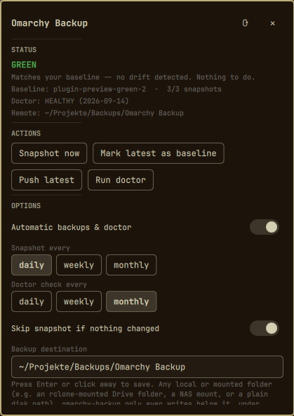

# omarchy-backup

Freeze a working Omarchy setup, notice when it drifts, and rebuild it on a
fresh install. Bash + `jq`/`zstd`/`rclone`/`tar` (all already on a stock
Omarchy box) -- no new runtime dependencies.

Security boundaries and remaining trust assumptions are documented in
[`SECURITY.md`](SECURITY.md).

## Concepts

- **Snapshot**: a named, timestamped capture of the reproducible parts of
  your workspace -- pacman/AUR packages, Omarchy plugin state, dotfiles and
  config, `~/.local/bin` scripts, systemd `--user` units, and the shared
  cross-agent knowledge (`~/.config/ai-agents`, per-agent config, and each
  project's `~/.claude/projects/*/memory`). At most **3** snapshots are kept
  at a time (see "Slot rotation" below).
- **Baseline**: one snapshot marked as "the known-good state". `status`
  diffs the live system against it.
- **Remote backup**: any snapshot can be pushed to an `rclone` remote
  (Google Drive, OneDrive, S3, SFTP, a local path, ...) for off-machine
  recovery.
- **Doctor**: a compatibility check that tells you whether this tool can
  still snapshot/diff/restore *this* Omarchy install -- see "Decay
  detection" below.

## What a snapshot contains, and what it deliberately doesn't

Declared in `~/.config/omarchy-backup/paths.conf` (defaults copied from
`config/paths.conf.default` on first run; add drop-ins under `paths.d/` for
local additions instead of editing it, so a future default update doesn't
clobber your changes). Ships with: Hyprland/Omarchy shell config, dock/theme
config, `~/.local/bin`, `~/.config/ai-agents` (the shared
Codex/Claude/Gemini knowledge base), each agent's small config files and
`~/.claude/projects/*/memory`, `mimeapps.list`/`user-dirs.dirs`, app launchers
(`~/.local/share/applications`, incl. Omarchy web apps and TUIs, plus
`~/.local/share/icons`), the mise tool list (`~/.config/mise/config.toml`), and your own
`~/.config/systemd/user/*.{service,timer,path}` unit files. Symlinks inside
included directories (e.g. `~/.local/bin/<tool>` pointing into a git
checkout) are recorded as links, never followed.

Handled separately, not via `paths.conf`:

- **Packages** (pacman explicit + AUR/foreign) and **Flatpak** apps are
  recorded as name lists, not file content -- restore reinstalls them.
- **Omarchy plugins**: a git-managed plugin (i.e. cloned via `omarchy plugin
  add`, which is how most third-party plugins arrive) is recorded as
  `{remote url, full commit SHA, uncommitted diff}` and reinstalled at exactly
  that commit (see restore step 2) -- not copied file-by-file. A plugin with
  **no** `.git` (i.e. your own, hand-written plugin) is embedded in the
  snapshot payload directly.
- **Your own git checkouts** (`repo <path>` lines in `paths.d/`, e.g. a
  tool that `~/.local/bin` symlinks into): recorded as `{remote, branch,
  commit, tracked diff}` and re-cloned on restore (step 4). Every snapshot
  also carries an embedded copy of the tracked files and a `git bundle`
  with as much history as a restore could otherwise lose:

  | Repo | Bundle in the snapshot |
  |---|---|
  | no `origin` remote | **full history** (all branches, tags, stash) |
  | `repo <path> full` | **full history**, even though a remote has it |
  | with `origin`, something not pushed | **missing commits only**: unpushed commits on any branch, plus annotated tags (no `git stash`) |
  | with `origin`, everything pushed | none -- **metadata only** (remote, commit, diff; no `git stash`) |

  Local branches and lightweight tags that point at already pushed commits
  are recorded by name in the manifest and recreated after the clone.
  Untracked files are not included; snapshots warn about them. A glob
  declares every git checkout it matches, so new projects need no extra
  line (non-git folders are skipped); `full` works with globs too:

  ```
  # ~/.config/omarchy-backup/paths.d/local-repos.conf
  repo ~/Projects/my-tool
  repo ~/Projects/important full
  repo ~/Work/*
  ```

  `full` is the trailing word of the line (a path itself ending in
  " full" cannot be declared). `omarchy-backup status` and `doctor` list
  per repo what the next snapshot carries ("full history", "missing
  commits only (N)", "metadata only"). Without `full`, the remote is the
  only complete copy of a pushed repo's history: if it disappears or is
  force-pushed, a restore gets the files but not the history.

  A full bundle holds the **whole** history, including anything ever
  committed and later deleted (a password, a key) and `git stash` entries,
  and it travels to your remote destination with every snapshot. If that is
  not wanted, add `exclude *.bundle` (all repos) or
  `exclude Projects__my-tool.bundle` (one repo) to a drop-in; such repos
  then come back from their remote, or as files only.

  Note that `exclude .git` in the default `paths.conf` applies to
  `include` lines: `include ~/Work` alone backs up the files of the repos
  in there, but not their history. Combine it with `repo ~/Work/*`.
  (History bundles, `repo` globs and the doctor check below go back to a
  suggestion from an omarchy-backup user, November 2026.)
  `doctor` warns about git repos whose history no backup covers (no remote
  or unpushed commits, not declared with `repo`), in the included folders
  and in `OB_CFG_REPO_SCAN_ROOTS` (default `~/Projects ~/Work`), and when a
  `~/.local/bin` link points into a checkout that is not declared.
- **AppImages**: only detected and listed (path + checksum) for you to
  re-fetch; not embedded (they're large, redistributable binaries).

Always-on safety nets, regardless of what `paths.conf` says:

- Any file over `OB_CFG_MAX_FILE_SIZE_MB` (default 20MB) is skipped and
  listed in the manifest's `skipped_large_files` / surfaced as a manual step
  on restore.
- Anything matching a secret-shaped pattern (`*credentials*`, `*token*`,
  `*secret*`, `*.key`, `*.pem`, `id_rsa*`, `.netrc`, ...) is never embedded,
  even if a path under it was included -- listed in `skipped_secret_files`.
  Agent CLI logins (`.credentials.json`, `auth.json`, `oauth_creds.json`),
  SSH/GPG keys and browser passwords are never covered by this tool; you
  re-authenticate each tool after a restore.

## Commands

```
omarchy-backup init                              # write default config/paths (idempotent; also runs automatically)
omarchy-backup snapshot [name] [--baseline] [--replace NAME]
omarchy-backup list
omarchy-backup show <name>                       # print a snapshot's manifest.json
omarchy-backup baseline <name>                    # mark an existing snapshot as baseline
omarchy-backup status                             # GREEN / YELLOW / RED vs. the baseline
omarchy-backup push <name>                         # upload a snapshot to the configured rclone remote
omarchy-backup remote-list                         # list snapshots available on the remote
omarchy-backup pull <name> [--signer-github U]     # download a snapshot from the remote (signature checked)
omarchy-backup restore <name> [--dry-run]          # pulls from remote automatically if not local
        [--signer-github U | --allowed-signers F] [--accept-unverified] [--yes] [--repos-from-snapshot]
omarchy-backup import <folder> [--signer-github U] # a snapshot folder downloaded by hand
omarchy-backup integrity check|record <name>|forget <name>|reset   # the destination vs. this machine's ledger
omarchy-backup doctor                              # compatibility / "decay" check
omarchy-backup timers install|status|uninstall     # systemd --user timers for automatic snapshot+doctor
omarchy-backup config list|get <KEY>|set <KEY> <VALUE>   # read/write config.conf safely (used by the bar widget)
```

Config: `~/.config/omarchy-backup/config.conf` (plain `KEY=VALUE`, see the
comments in the generated file for every option: enable/disable automatic
runs, snapshot/doctor frequency, remote name/path, retention, size cap).

## Everyday use

```bash
# after getting your system into a state you like:
omarchy-backup snapshot my-good-state --baseline
omarchy-backup push my-good-state   # if you've set OB_CFG_REMOTE_NAME

# any time later, to see if anything has drifted:
omarchy-backup status
```

`status` output:

```
Status: YELLOW (drift against baseline 'my-good-state')

Changed:
  ~/.config/hypr/

Added:
  package: foo

Removed:
  package: bar
```

- **GREEN** -- matches the baseline.
- **YELLOW** -- packages/plugins/files added, changed, or removed vs. the
  baseline.
- **RED** -- the baseline snapshot itself is missing/corrupt, or a required
  tool (`jq`/`zstd`/`tar`/`sha256sum`) is gone.

### Slot rotation

Only 3 snapshots are kept. Creating a 4th:

- interactively, asks which of the 3 to replace (never picks your baseline
  for you);
- non-interactively (a timer run, or stdin redirected from `/dev/null`),
  auto-replaces the **oldest non-baseline** snapshot and logs the decision;
- `--replace NAME` picks explicitly either way.

Snapshot names are a single path component: 1–128 ASCII letters, digits,
periods, underscores, or hyphens, starting with a letter or digit. The same
grammar is enforced for CLI arguments, local state, and remote index entries.

## Automatic backups

```bash
omarchy-backup timers install
```

Installs and enables (per `OB_CFG_ENABLED` in config.conf)
`omarchy-backup-snapshot.timer` and `omarchy-backup-doctor.timer` into
`~/.config/systemd/user/`, with `OnCalendar=` taken from
`OB_CFG_SNAPSHOT_FREQUENCY` / `OB_CFG_DOCTOR_FREQUENCY` (`daily` / `weekly` /
`monthly`, or any literal systemd `OnCalendar=` expression). Re-run `timers
install` after changing either frequency in config.conf.

- An automatic snapshot run (`snapshot --auto`) skips creating a new
  snapshot when `status` is already GREEN (`OB_CFG_SKIP_AUTO_IF_CLEAN`), and
  fires an out-of-cycle `doctor` run first if it notices Omarchy itself was
  updated since the last check (see below) -- so you're not left DEGRADED
  for a whole month after a big Omarchy update. A YELLOW state creates a
  rolling snapshot and automatically pushes it when a remote destination is
  configured. RED/UNKNOWN states are refused: repair or establish the
  known-good baseline first. A missing remote leaves the snapshot local and
  emits a warning. If a remote **is** configured but currently unavailable
  (see "Destination availability" below), the run is still **local first**:
  the snapshot is created locally, only the upload is postponed, and the run
  exits with 75; the systemd unit then retries every 15 minutes (at most 4
  attempts in 3 hours). A retry first uploads pending snapshots (latest and
  current baseline) and never creates a duplicate: automatic runs skip
  creating a new snapshot when nothing changed since the latest local one.
- Every upload (`push`, automatic or manual) is verified with `rclone check`
  against the local snapshot. A failed copy or verification is retried up to
  3 times (10 s apart) within the same push -- a single file can get lost on
  a caching mount. Only a verified upload is added to the remote index; if
  all attempts fail, `push` exits with 75 and an automatic run is retried by
  systemd like an unavailable destination.
- An automatic `doctor --auto` run that comes back DEGRADED sends a desktop
  notification (`notify-send`) in addition to the journal log, since a log
  line nobody reads isn't "visible" to you.

Check timer status: `omarchy-backup timers status` (wraps `systemctl --user
list-timers`). Remove them: `omarchy-backup timers uninstall`.

## Remote backup

Optional recovery notes: set `OB_CFG_RECOVERY_NOTES` to a Markdown/text file
(e.g. `omarchy-backup config set OB_CFG_RECOVERY_NOTES ~/notes/recovery.md`)
and every push copies it to `<destination>/<hostname>/RECOVERY.md` -- your
"how to get back up" notes (repo URLs, logins to redo) are then readable
straight from the backup destination before anything is installed.

Storage-agnostic via `rclone` -- two ways to point it somewhere, both driven
by `OB_CFG_REMOTE_PATH`:

```
# Option A: a plain local or mounted folder (an rclone-mounted Drive folder,
# a NAS mount, an external disk, ...) -- leave the remote name empty and
# make the path absolute. This is what the bar widget's destination field
# sets.
OB_CFG_REMOTE_NAME=
OB_CFG_REMOTE_PATH=/home/you/Projekte/Backups

# Option B: a raw rclone remote not mounted anywhere locally (S3, SFTP, a
# Drive remote you don't want FUSE-mounted, ...) -- CLI-only, see below.
OB_CFG_REMOTE_NAME=gdrive        # must match `rclone listremotes`
OB_CFG_REMOTE_PATH=omarchy-backup

OB_CFG_RETENTION_REMOTE=3
```

Set option B from the CLI: `omarchy-backup config set OB_CFG_REMOTE_NAME
<name>`. Whichever is set, this tool only ever calls generic `rclone
copy`/`cat`/`purge` against it -- a bare local path is just as valid an
rclone destination as `remote:path`, so both modes share 100% of the same
push/pull/retention code. Layout at the destination:

```
<remote_path>/<hostname>/
  index.json                  # lightweight listing of every pushed snapshot
  <snapshot-name>/
    manifest.json
    checksums.sha256
    payload.tar.zst
```

`push` updates `index.json` and prunes remote snapshots beyond
`OB_CFG_RETENTION_REMOTE`. The known-good baseline is always retained; the
remaining slots contain the newest rolling snapshots (the default `3` means
one baseline plus two rolling copies). Every push first validates the local
payload checksum, then runs `rclone check` after copying. A snapshot is marked
as pushed and indexed only after that comparison succeeds. `restore <name>` pulls
automatically from the remote if the snapshot isn't present locally --
that's the fresh-install path (see below).

Remote metadata is treated as untrusted input. Index reads have a 256 KiB
producer-side limit and a 20-second hard deadline; indexes are rejected unless
they contain at most 256 schema-valid entries with bounded strings and safe
snapshot names. Retention constructs every deletion beneath the configured
host backup prefix only after that validation. Other remote operations have a
15-minute hard deadline, and pulls request only the three expected snapshot
files.

Local backup configuration, state, logs, snapshot directories, and snapshot
files are kept owner-only (`0700` directories / `0600` files). Existing data is
normalized to those permissions when the CLI initializes its directories.

These checks prevent path traversal, unbounded metadata buffering, and stalled
remote operations. The current checksum design detects accidental corruption,
but is not a cryptographic authenticity proof against a storage provider that
can replace both a snapshot and its manifest. Treat the configured backup
account according to your own threat model, use its access controls/version
history, and review a remote restore with `--dry-run` when appropriate. Restore
remains an explicit user-controlled operation: the tool provides the mechanism
and evidence, while the user owns the decision to apply a self-created state.

### Which baseline is protected remotely

Remote retention always keeps **the baseline you most recently set on
purpose** (`omarchy-backup baseline <name>` or `snapshot --baseline`;
automatic runs never set one) and fills the remaining
`OB_CFG_RETENTION_REMOTE` slots with the newest rolling snapshots. Earlier
baselines are demoted in the remote index and rotate out like rolling
snapshots -- including ones whose local slot has already rotated away. The
switch happens only once the newly set baseline has actually been pushed, so
the remote is never without a protected baseline.

### Destination availability

Every write to the destination (push, index update, retention) is gated,
for both destination modes:

1. **The destination root must already exist** (local/mounted path) or the
   rclone remote must answer. The tool never creates the configured root
   itself -- otherwise an unmounted drive would silently receive the backup
   in its empty mountpoint on the local disk.
2. **Identity marker**: the first push writes a random id to
   `<remote_path>/.omarchy-backup-destination` and remembers it in
   `state.json` (`.destinations`). Later writes require exactly that marker,
   which also catches an existing-but-empty mountpoint or a different drive
   mounted at the same path. A fresh install (empty state) adopts an existing
   marker, so restoring onto a new machine keeps working. To deliberately
   switch to a new empty destination, just configure the new path -- markers
   are tracked per destination.

`doctor` performs the same check read-only and reports the concrete reason.
Index reads are retried briefly, because caching mounts can serve stale or
zero-filled content right after the index was replaced.

## Never trust the destination

Whoever can write to the backup destination (a shared cloud folder, a
compromised account, another device syncing it) could replace a snapshot
and recompute every checksum inside it. A restore then writes and runs that
content: scripts in `~/.local/bin`, systemd units, hooks, agent
instructions. So the destination and everything in a snapshot are treated
as untrusted, with three independent layers:

**1. Integrity ledger (this machine).** After every verified upload the
files this machine just wrote -- and only those, each checked against the
local copy -- are recorded in
`~/.local/share/omarchy-backup/integrity-ledger.json` (never uploaded): with
the backend's own MD5 where it offers one without downloading
(`rclone lsjson --hash`, e.g. Google Drive), else size and modification
time (listed in UTC, so DST or time zone changes are no "change"). The
ledger is never re-baselined from what the destination shows: a file
nobody recorded stays a problem. Every automatic run and `doctor` compare the destination
with it. A changed, added or removed file of a known snapshot -- or an
unknown snapshot folder -- raises a critical desktop notification, turns
`status` (and the widget) RED and makes `doctor` FAIL with the exact files.
The local backup itself keeps running, but nothing is uploaded to (or
recorded from) a destination with unresolved problems. The notification
comes once per new set of problems; `status`/`doctor` stay red until it is
resolved. `pull` downloads into a private staging folder, never replaces an
existing local snapshot, and refuses content that differs from what this
machine uploaded.

Resolving: look at the files `doctor` names, delete what is not yours on
the destination, then `omarchy-backup integrity forget <name>` for a
snapshot you deleted, or -- after a full cleanup -- `omarchy-backup
integrity reset` (the next push records the destination anew).

- Destination is an rclone remote (`OB_CFG_REMOTE_NAME`): MD5 from the
  backend, no download.
- Destination is a mounted cloud folder (rclone mount, FUSE): hashing it
  would download every file, so only size + date are compared, and `doctor`
  says so. Set `OB_CFG_INTEGRITY_RCLONE_REMOTE` to the same folder as an
  rclone spec (e.g. `mydrive:backups/omarchy` when `mydrive:` is the
  mounted remote) to get the MD5 check. The mount hands uploads to the
  backend a few seconds later (rclone VFS write-back), so right after a push
  recording waits until the backend shows exactly the uploaded files (up to
  300 s, `OMARCHY_BACKUP_INTEGRITY_SETTLE_SECONDS`; poll every 5 s,
  `OMARCHY_BACKUP_INTEGRITY_SETTLE_POLL`). It never accepts less: whatever
  still differs then fails the push as before.
- Plain local disk/NAS folder: hashed locally.
- Uploads from before the ledger existed are listed by `doctor`; after
  checking one (`restore --dry-run` with signature verification), adopt it
  with `omarchy-backup integrity record <name>`: with a local copy only its
  four files are adopted, and only if the destination's match it (anything
  else there stays a problem); without a local copy it needs `--yes` and
  says what it trusts. A snapshot uploaded *after* the ledger existed but
  missing from it is a problem, never "unrecorded".
- An upload whose destination listing does not match what was just sent
  counts as failed (not marked uploaded, alert, retried by the next run).
- A folder named after a local snapshot newer than the last successful
  upload is that snapshot's unfinished upload (the retry overwrites it and
  records only its own files); any other unknown folder is a problem.
- `omarchy-backup integrity check` runs the comparison on demand.

The ledger's trust ends with this machine. After a reinstall, layer 2
takes over.

**2. Signatures.** Every snapshot's `manifest.json` (which holds the
payload's and `checksums.sha256`'s SHA-256) is signed with an SSH key
(`ssh-keygen -Y sign`, namespace `omarchy-backup`; no new dependency) and
uploaded as `manifest.json.sig`; so are the tool copy
(`omarchy-backup-tool.tar.gz.sig`) and `RECOVERY.md.sig`. The trust anchor never comes from the
backup: your GitHub account's public **signing** keys
(`OB_CFG_SIGNER_GITHUB`, or `--signer-github <user>` on a fresh install)
and/or a local file of trusted public keys (`OB_CFG_ALLOWED_SIGNERS`,
`--allowed-signers <file>`). `restore`, `import` and `pull` verify first:
a valid signature is reported with the key's fingerprint; an invalid,
missing or unverifiable one gives a loud warning and continues only after an
explicit "yes" -- or `--accept-unverified` in a non-interactive run. The
decision stays yours; it is never silent. `doctor` warns while no key is
configured or GitHub does not list it.

**Note your key's fingerprint outside the backup** (password manager,
paper): `ssh-keygen -lf ~/.config/omarchy-backup/signing_key.pub`. Every
"Signature OK: ... key SHA256:..." line on restore names the key that
signed; compare it with your note. That is the check for "someone added
their own signing key to my GitHub account" -- see "Deliberate limits".

One-time setup (the nightly run is non-interactive, so the key has no
passphrase; it is never put into a snapshot, whatever it is called):

```
ssh-keygen -t ed25519 -N '' -C omarchy-backup -f ~/.config/omarchy-backup/signing_key
gh auth refresh -h github.com -s admin:ssh_signing_key
gh ssh-key add ~/.config/omarchy-backup/signing_key.pub --type signing --title omarchy-backup
omarchy-backup config set OB_CFG_SIGNING_KEY ~/.config/omarchy-backup/signing_key
omarchy-backup config set OB_CFG_SIGNER_GITHUB <your-github-user>
omarchy-backup doctor        # "Snapshot signatures  OK"
```

The tool copy and `RECOVERY.md` come from the destination like everything
else, and the tool copy would run before anything else is checked: **verify
them before you unpack or follow them**, by hand, against your GitHub
signing keys:

```
curl -s https://api.github.com/users/<you>/ssh_signing_keys | jq -r '.[].key' \
  | sed 's/^/backup-signer namespaces="omarchy-backup" /' > allowed
ssh-keygen -Y verify -f allowed -I backup-signer -n omarchy-backup \
  -s omarchy-backup-tool.tar.gz.sig < omarchy-backup-tool.tar.gz
```

("Good ... signature" = genuine, with the key's fingerprint -- compare it
with your note; the same works for `RECOVERY.md`.)

If the key is lost, snapshots signed with it still verify as long as the
public key stays on GitHub; if it leaks, delete it there -- every snapshot
it signed then stops verifying.

**3. Restore review.** The payload is copied once into a private folder
under the data dir, checked and unpacked there (size-capped), and that one
tree is reviewed and restored -- nothing can swap the archive in between.
Before anything is written, `restore` lists **every** file it would add or
change, per folder with counts, and shows each one -- an excerpt for new
files, a diff for changed ones -- except pure data (images, fonts). On a
fresh install that is everything, on purpose: a theme, a terminal config or
`mimeapps.list` can run code as well as a script can. Then come the
packages it would install (AUR ones are built from source), the systemd
units it would enable/start, and the plugins and repos it would fetch.
Package and unit names from the snapshot that are not valid names are
ignored and reported. Code and configuration (scripts, units, hooks,
plugins, themes, Hyprland/terminal/shell/editor config, autostart and
`.desktop` entries, git/ssh/gpg/gh config, agent files, `mimeapps.list`,
...) is shown in full up to 200 lines per file, other files as an 8-line
excerpt. The complete review always goes to
`~/.local/share/omarchy-backup/restore-review-<name>-<time>.txt`; on a
terminal a long one opens in `$PAGER` (default `less -R`). It then asks; a
non-interactive run needs `--yes`. `--dry-run` shows the same.

The unpacked payload may be at most 50x its compressed size (at least
64 MB, at most `OB_RESTORE_MAX_UNPACKED_MB`, default 1024). A local
snapshot folder without `manifest.json` (an interrupted download) is moved
aside as `<name>.stale-<time>` before the restore downloads it again;
staging leftovers older than a day are cleaned up.

The tool's own configuration is never activated by a restore:
`config.conf` is sourced as code and holds the trust settings, and
`paths.conf` / `paths.d/*.conf` decide what the next automatic run uploads
(a hostile `include` line could send files to the destination). Each is
written as `<file>.restored` (the review shows its diff, or up to 200 lines);
adopt them after reading, e.g. `mv ~/.config/omarchy-backup/config.conf.restored
~/.config/omarchy-backup/config.conf`. Until then automatic runs use the
current rules. A payload file named like a secret (the same name rules that keep
secrets out of a snapshot, so a genuine snapshot cannot contain one) or
sitting at this machine's signing-key path is never written.

The review shows control characters in file content as `^?`, so an escape
sequence in a snapshot cannot hide or rewrite lines on the terminal.

### Deliberate limits

The goal is a backup you can control yourself with plain tools -- no
encryption, no key server, no extra services. The checks above stop at the
points below **on purpose**; each has a manual check instead of more
machinery. Please read these as design decisions, not oversights.

The rule behind them: omarchy-backup must not make your machine easier to
attack than it would be without it. It does not try to defend against every
way a backup could be tampered with. Where you keep your snapshots and what
you choose to restore is your responsibility; the tool shows you what it
finds (preview, warnings) instead of adding more protection layers. Someone
who can already write to your home folder is out of scope.

- **No encryption.** The destination is meant to be your own (a cloud
  folder or NAS only you use). Snapshots stay readable with stock
  `zstd`/`tar`; secrets are kept out by name rules, credentials never go in.
- **Every signing key on the GitHub account is trusted.** There is no
  fingerprint pin and no watch on the account's key list. Whoever controls
  your GitHub account (and can write to the destination) could sign a forged
  snapshot. Manual check: the fingerprint note above, compared with the
  "Signature OK" line. Protect the GitHub account (2FA) like the backup itself.
- **The tool copy and `RECOVERY.md` are not verified by the tool.** A tool
  copy cannot vouch for itself, and on a fresh machine nothing else is
  installed yet. Manual check: `ssh-keygen -Y verify` as shown above before
  unpacking -- or skip the tool copy and `git clone` this repository.
- **A snapshot's folder name is not bound to its signature.** An old,
  genuine snapshot could be offered under a newer name; it would verify. On
  the machine that uploaded it the integrity ledger catches this. Elsewhere:
  `restore` prints the signed creation date ("created ...") -- check it.
  Against someone who can write to the destination, freshness cannot be
  guaranteed anyway: they can simply delete the newer snapshots.
- **An unverified snapshot you accept can run code.** Scripts, units, hooks
  and shell config come back with it; the review shows them, but it cannot
  judge them. Answer "yes" to an UNVERIFIED snapshot only if you know why it
  is unverified.

These limits and the hardening above (held-back path rules, refused secret
files, escape-safe review, verify-first recovery steps) come from a review by
[bernhard2804](https://github.com/bernhard2804)
([#1](https://github.com/mstio/omarchy-backup/issues/1)).

## Restore (fresh Omarchy install -> your workspace)

```
Fresh Omarchy install
  -> install rclone, git this repo (or copy it) to ~/Projects/omarchy-backup
  -> if any of your own git-managed plugins live in a *private* repo:
     gh auth login && gh auth setup-git   (so `omarchy plugin add` can clone them)
  -> ./install.sh
  -> edit ~/.config/omarchy-backup/config.conf (set OB_CFG_REMOTE_NAME)
  -> omarchy-backup remote-list          # see what's available
  -> omarchy-backup restore <name> --dry-run --signer-github <you>   # review the plan first
  -> omarchy-backup restore <name> --signer-github <you>
```

The restore first checks the snapshot's signature against your GitHub
signing keys (or `--allowed-signers <file>`), then lists the content that
runs as code and asks before writing it; see "Never trust the destination"
below.

**Without git or rclone**: every push also leaves a copy of this tool
(`omarchy-backup-tool.tar.gz`) and your recovery notes (`RECOVERY.md`, see
`OB_CFG_RECOVERY_NOTES`) next to the snapshots. On a fresh machine you can
download both (with their `.sig` files) plus a snapshot folder from the
destination in a browser. Prefer a fresh `git clone` of this repository over
the tool copy whenever GitHub is reachable -- your signing keys live there
anyway. Otherwise **first** verify the tool copy as shown under "Never trust
the destination" (`ssh-keygen -Y verify ... -s omarchy-backup-tool.tar.gz.sig`)
and continue only on "Good ... signature":

```
tar -xzf omarchy-backup-tool.tar.gz -C ~/Projects && ~/Projects/omarchy-backup/install.sh
omarchy-backup import ~/Downloads/<snapshot-folder> --signer-github <you>
omarchy-backup restore <name> --dry-run --repos-from-snapshot --signer-github <you>
omarchy-backup restore <name> --repos-from-snapshot --signer-github <you>
```

Without a good signature, do not run the tool copy (the integrity ledger
on the old machine, if it still exists, also lists its MD5).

Note: snapshots are stored per hostname (`<destination>/<hostname>/`), so
give the fresh install the same hostname (or `hostnamectl set-hostname`)
before `remote-list`. The destination does not have to be mounted yet: point
`OB_CFG_REMOTE_NAME`/`OB_CFG_REMOTE_PATH` at the rclone remote for the
restore; your own `config.conf`, `paths.conf` and `paths.d/` come back as
`*.restored` (adopt them after reading, see "Never trust the destination");
the units that mount the destination again come back with the payload.

Note: any plugin the manifest lists as git-managed (`plugins.git_managed` --
this includes not just third-party plugins but your own, once you `git
init` one) gets reinstalled via `omarchy plugin add <remote-url>` (step 2
below). If that remote is a **private** repo, the clone needs git
credentials for it -- run `gh auth login`/`gh auth setup-git` (or set up an
SSH key) before restoring, or that one step is simply skipped and reported
as a manual step at the end rather than failing the whole restore.

`restore` is staged and always dry-runnable:

1. **Packages** -- installs missing native packages (`pacman -S --needed`)
   and AUR packages (`yay`/`paru -S --needed`; noted as a manual step if
   neither is installed).
2. **Omarchy plugins** -- for each git-managed plugin, clones the recorded
   remote into a staging directory, checks out the recorded **full commit
   SHA** detached, and only then hands that staging checkout to `omarchy
   plugin add` (which runs Omarchy's own manifest validation and id checks
   and clones exactly that commit). Origin is then pointed back at the real
   remote. Any uncommitted local diff is reapplied (saved to
   `~/.local/share/omarchy-backup/restore-<id>.diff` for manual review if it
   no longer applies cleanly). Finally every previously-enabled plugin
   (built-in or third-party) is re-enabled. A plugin whose pinned commit
   cannot be found at its remote, whose recorded id/remote/commit is
   malformed, or whose repository declares a different plugin id is **neither
   installed nor enabled** -- it is listed as a manual step instead of
   silently falling back to whatever upstream's default branch contains
   today. The manifest's pin is what the snapshot promises; restore keeps
   that promise or says so.
3. **Scripts, dotfiles, themes, agent config, machine memory** -- see below
   (this step runs before the checkouts so their embedded copies are there).
4. **Own git checkouts** (`repo` lines) -- clones each recorded remote into
   its old place under `$HOME`. If the remote's branch already contains the
   snapshot commit, its current tip is kept (work pushed after the snapshot
   survives); otherwise the snapshot commit is checked out detached, and a
   commit the remote never received is reported. Tracked uncommitted edits
   are reapplied; commits, branches and tags the remote never received are
   added from the snapshot's history bundle and the recorded local refs (a
   branch tip the remote moved past is never moved back). An existing directory is never touched. Private repos need
   `gh auth login && gh auth setup-git` first; otherwise the clone is listed
   as a manual step and the restore can simply be re-run later. **Without
   a usable remote** (none recorded, no GitHub login, no network, or
   `restore --repos-from-snapshot`) the repo is rebuilt from a **full**
   history bundle: all branches and tags, `origin` set to the recorded
   remote if there was one, the recorded branch checked out and tracked
   uncommitted edits reapplied. A "missing commits only" bundle cannot do
   that (it builds on the remote's commits), and neither can a repo with
   no bundle, an older snapshot's oversized bundle or a machine without
   git: then the file-only copy is unpacked instead, and the restore says
   that `repo <path> full` would have kept the history (tracked files with
   uncommitted edits, no history); the restore then prints the commands to
   reconnect it to git later. Both live under
   `~/.local/share/omarchy-backup/repo-sources/`.

   Payload details (step 3): the
   payload is extracted to `$HOME`. This one step covers `~/.local/bin`,
   Hyprland/Omarchy config, and the shared agent knowledge base +
   per-project machine memory, including recreating the
   `~/.claude/CLAUDE.md` / `~/.codex/AGENTS.md` / `~/.gemini/GEMINI.md`
   symlink triplet as symlinks (not copies).
5. **systemd user units** -- copies your unit files back, `daemon-reload`,
   then enables/starts exactly the units that were enabled/active in the
   snapshot.
6. **Symlink structure** -- a side effect of step 4 (tar preserves symlinks
   as symlinks).
7. **Integrity check** -- every restored file's checksum is re-verified
   against `checksums.sha256`.
8. **Manual steps** -- printed at the end: anything skipped as too
   large/secret at snapshot time, AppImages to re-fetch, Flatpak apps to
   reinstall, any step that failed automatically, and the standing note
   that secrets/logins are never restored automatically.

**Never silently overwrites your data**: any existing file that a restore
would change is copied aside first, as `<file>.bak.<timestamp>`, right next
to itself (the convention already used elsewhere on this machine).

### What's *not* fully automated

- Re-authenticating agent CLIs (Claude Code, Codex, Gemini/Antigravity) and
  any app with a login -- credentials are deliberately never in a snapshot.
- SSH/GPG keys, browser profiles/passwords, and anything else outside
  `paths.conf`'s declared scope.
- AppImages and Flatpak apps are only listed, not reinstalled for you.
- Tools pinned via mise (agent CLIs, `gh`, `node`) are restored as the list in
  `~/.config/mise/config.toml`; restore names `mise install` as a manual step.
- A plugin's uncommitted local patch that no longer applies cleanly against
  a newer upstream commit (rare, but the diff is saved for manual review).
- Cloning a git-managed plugin from a **private** repo (including one of
  your own, the moment you `git init` it) -- needs git/GitHub credentials
  set up on the fresh machine first (`gh auth login` + `gh auth setup-git`,
  or SSH keys); otherwise that one plugin is skipped and listed as a
  manual step rather than failing the whole restore.
- A git-managed plugin whose recorded commit no longer exists upstream
  (history rewritten, repository replaced) -- deliberately not installed and
  not enabled; review upstream yourself, then install manually.
- Full bit-for-bit fidelity is explicitly a non-goal; the target is "fresh
  Omarchy -> functionally the same personal workspace."

### Manual recovery without this tool

Snapshots deliberately use standard, inspectable files rather than a private
container format. `payload.tar.zst` is a Zstandard-compressed tar archive,
`manifest.json` is JSON, and `checksums.sha256` is plain text. If this project
ever disappears or stops running, recover a snapshot with stock tools:

```bash
snapshot=/path/to/snapshot-name
staging="$(mktemp -d)"

# Compare this output with: jq -r .payload.sha256 "$snapshot/manifest.json"
sha256sum "$snapshot/payload.tar.zst"

# Inspect first, then extract into an empty staging directory -- not over $HOME.
zstd -dc "$snapshot/payload.tar.zst" | tar -tf -
zstd -dc "$snapshot/payload.tar.zst" | tar -x -C "$staging"

# Verify regular files. Custom `symlink:...` records are inspected separately.
grep -v '^symlink:' "$snapshot/checksums.sha256" > "$staging-checksums.sha256"
(cd "$staging" && sha256sum -c "$staging-checksums.sha256")
grep '^symlink:' "$snapshot/checksums.sha256" || true
```

Review the extracted tree and copy back only the files you want. Package lists,
plugin remotes/commits, user-unit states, skipped files, and other reconstruction
metadata remain readable with `jq` in `manifest.json`. Automated restore is a
convenience layer over this format, not a prerequisite for accessing the data.

Backward-readable, tool-independent payloads are a format invariant. Future
authenticity metadata must be a detached sidecar and must not make manual tar
extraction depend on `omarchy-backup`.

## Protection against backup and tool decay

There are three different failure modes to defend against: a saved snapshot
can become unusable, Omarchy can evolve until the installed tool no longer
fits the system, or the local checkout of this tool can disappear. They are
handled separately.

### Backup-data decay

- The known-good baseline is never selected by automatic local slot rotation
  or remote retention. The remaining slots are replaceable rolling snapshots.
- Automatic runs save **YELLOW** drift because it may be the only recoverable
  version of a still-functioning system. They never silently promote it to the
  known-good baseline. **RED/UNKNOWN** is refused because it cannot establish a
  trustworthy recovery point.
- Every snapshot contains a manifest and SHA-256 file checksums. Before upload,
  the local payload checksum is validated; after upload, `rclone check` compares
  the remote files. Only a successful comparison marks a snapshot as pushed and
  adds it to `index.json`.
- Restore is dry-runnable and verifies restored files. Existing files are moved
  aside as `.bak.<timestamp>` before replacement. Secret-shaped and oversized
  files remain explicitly excluded and are reported as manual steps instead of
  being silently assumed safe.

These checks detect corruption and incomplete transfer; they do not prove that
the current desktop state is desirable. GREEN means “matches the selected
baseline,” and YELLOW means “drift was preserved,” not “the changed state was
approved.” A restore on a disposable VM or spare machine remains the strongest
end-to-end test.

### Tool/environment decay (`doctor`)

Omarchy's directory layout, plugin system, or package tooling can change over
time and quietly break backup or restore. `doctor` checks: Omarchy version
detected, expected directories present, plugin detection working, package
inventory working, configured paths resolving to something, machine memory
readable, the agent symlink triplet intact, declared own git checkouts
present (and no `~/.local/bin` link into an undeclared one), no git history
outside the backup (repos without remote or with unpushed commits that are
not declared with `repo`; searched a few levels deep in the included folders
and `OB_CFG_REPO_SCAN_ROOTS`, never across filesystems), this tool's own systemd units
well-formed, the remote reachable, a snapshot still creatable, the latest local
manifest well-formed, its checksum valid, and the commands `restore` depends on
(`pacman`, `git`, `systemctl`, `omarchy`) still present.

```
Omarchy version             OK
Expected directories         OK
Plugin detection             OK
Package detection            OK
Config paths                 OK
Machine memory               OK
Agent configuration          OK
systemd units                OK
Remote backup                OK
Own git checkouts            OK
Unprotected git history      OK
Snapshot capability           OK
Snapshot manifest            OK
Checksum validity             OK
Restore plausibility          OK

Compatibility status: HEALTHY
```

Any WARN or FAIL flips the overall status to `DEGRADED` and lists details.
Runs manually (`omarchy-backup doctor`) or on its own monthly timer (see
above); an Omarchy version change is also caught opportunistically by every
automatic snapshot run, which triggers an extra doctor pass right away
instead of waiting for the monthly one. This is a deliberately simple
mechanism (compare `pacman -Q omarchy`'s version string to the last one
seen) rather than hooking pacman itself -- a user-level tool has no clean,
non-fragile way to hook a system-level pacman transaction.

`doctor` is an early-warning compatibility probe, not a formal proof of every
restore branch. Its snapshot-capability test and latest-checksum validation
catch common silent regressions; the self-contained test suite and an occasional
real fresh-install restore cover the deeper path.

### Recovering the tool itself

Snapshots deliberately do not embed this repository checkout. The installed
`~/.local/bin/omarchy-backup` is a symlink to that checkout, so neither is an
independent rescue copy. The public GitHub repository is the canonical
off-machine copy of the program: on a fresh Omarchy installation, clone it and
run `./install.sh` first, then use `remote-list`, `pull`, or `restore` to recover
your snapshots. Keep the repository URL with your remote-storage recovery
notes, because credentials are intentionally not inside the backup.

## Bar widget (optional)

[`mst.omarchy-backup`](https://github.com/mstio/mst.omarchy-backup) is the
optional companion Omarchy shell bar-widget plugin. It is an independent UI
repository and requires this CLI on `PATH`; restore never depends on the
widget. Install it with:

```bash
omarchy plugin add https://github.com/mstio/mst.omarchy-backup.git --enable
```



It shows a status dot (colored like `status`'s GREEN/YELLOW/RED) in the bar
and opens a dialog on click with:

- **Status**: color, baseline name/snapshot count, last doctor result, remote.
- **Actions**: Snapshot now / Push latest / Run doctor (each backgrounded,
  spinner while running, result shown inline).
- **Options**: every `config.conf` key -- automatic backups on/off,
  snapshot/doctor frequency, the backup destination (a plain local/mounted
  folder path -- see below), remote retention count, and the per-file size
  cap.

Never edits config.conf directly -- every change goes through
`omarchy-backup config set`, so the CLI and the widget can never disagree
about what's valid.

**Backup destination is a plain path field, deliberately not a native
folder picker or an rclone-remote dropdown:**
- A native `QtQuick.Dialogs` `FolderDialog` was tried and **reliably crashed
  a `gdbus` helper process** in this Quickshell environment (SIGABRT inside
  GLib's GVariant D-Bus message parsing, via `coredumpctl`) the moment it
  was opened -- an environment-level Qt/portal incompatibility, not
  something fixable from plugin QML. Do not re-add a native file/folder
  dialog here without first confirming it's actually stable in *this*
  Quickshell build.
- An rclone-remote dropdown (`rclone listremotes`) plus a
  folder-within-that-remote picker was also tried and worked, but made it
  ambiguous which of "local folder" vs "remote" was actually the live
  destination when both were visible at once. Simplified back to one field.
- The path typed here is `OB_CFG_REMOTE_PATH` with `OB_CFG_REMOTE_NAME`
  empty -- i.e. exactly the "local/mounted folder" mode described above
  under Remote backup. A raw rclone remote (S3, SFTP, a Drive remote not
  mounted locally, ...) is still fully supported by the CLI/`lib/remote.sh`
  -- set it with `omarchy-backup config set OB_CFG_REMOTE_NAME <name>` --
  it just isn't exposed as a widget control; the widget shows a note when
  one is set (it takes priority over the folder field).

## Testing

```bash
tests/run-tests.sh
```

Self-contained: creates its own throwaway `$HOME`s under `mktemp -d` and a
local-directory `rclone` remote, so it never touches your real system.
Covers: init, snapshot+baseline, GREEN/YELLOW drift detection, remote
push + fresh-`$HOME` restore (this is what proves checksums are portable,
not tied to the exact `$HOME` path a snapshot was taken under), the
never-silently-overwrite backup-aside behavior, dry-run writing nothing,
`doctor` running end to end, 3-slot rotation/replacement, verified automatic
YELLOW uploads, baseline retention, corrupt-payload rejection, and failed
remote-check handling. Security regressions additionally cover rejected local
and remote traversal names, fail-closed malicious indexes, deletion-prefix
containment, remote-read deadlines, owner-only local backup permissions, and
manual extraction with stock `zstd`/`tar` tools (71 assertions total).

To actually validate a fresh-install restore for real (not just the test
suite's simulation), the most convincing check is a real spare
machine/VM: install Omarchy, run `install.sh`, `restore <name>
--dry-run` first, review it, then run it for real and compare
`omarchy-backup doctor` and a spot-check of the desktop against the
original.

## Architecture

```
bin/omarchy-backup        dispatcher, one function per subcommand
lib/common.sh             config/paths.conf loading, logging, secret-glob safety net
lib/inventory.sh          pacman/AUR/flatpak/plugin/systemd-unit inventory -> JSON
lib/manifest.sh           paths.conf -> resolved file list, checksums.sha256
lib/snapshot.sh            snapshot creation, state.json (3-slot rotation)
lib/baseline.sh             baseline marking, GREEN/YELLOW/RED drift diff
lib/remote.sh               rclone push/pull/list/retention
lib/restore.sh               staged, dry-runnable restore
lib/doctor.sh                 compatibility checks
lib/timers.sh                  systemd --user timer install/status/uninstall
config/paths.conf.default        shipped default include/exclude rules
systemd/*.service,*.timer         unit templates (@EXEC@/@ONCALENDAR_*@ placeholders)
tests/run-tests.sh                 self-contained test suite
```

State lives in `~/.local/share/omarchy-backup/`: `state.json` (slot
bookkeeping, baseline pointer, last doctor result) and
`snapshots/<name>/{manifest.json,checksums.sha256,payload.tar.zst}`.

## License

[MIT](LICENSE)
